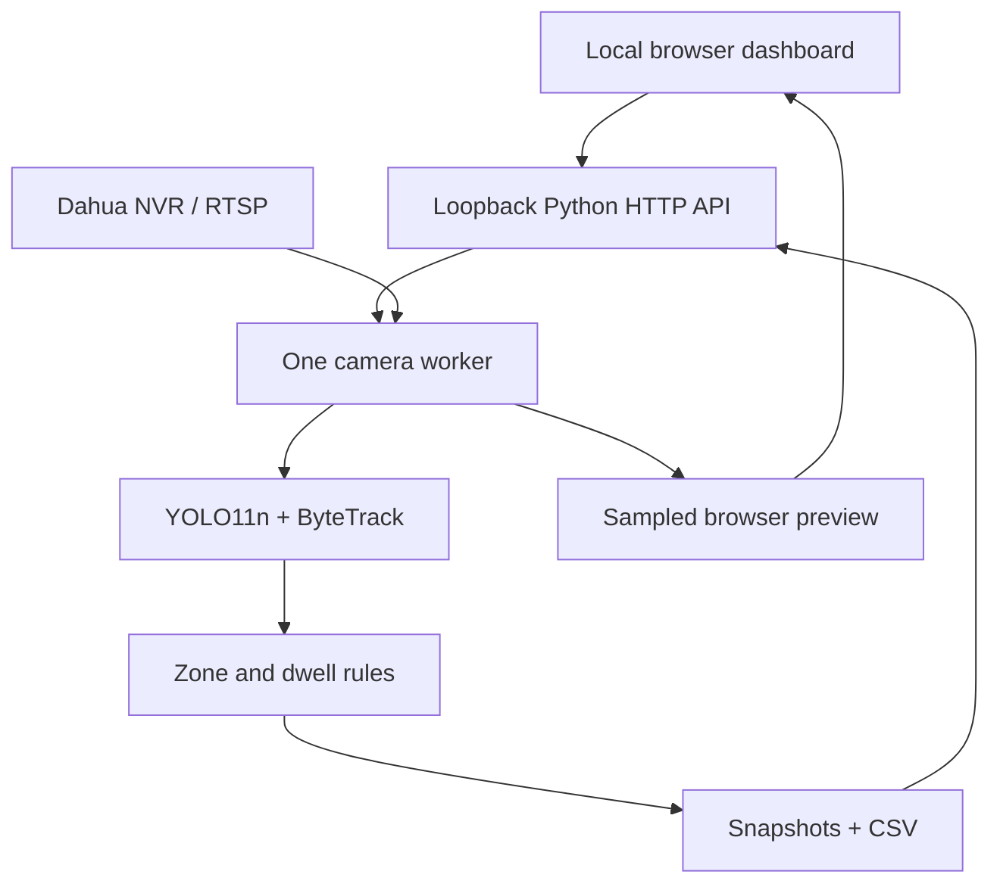

# Sentinel Desk · CCTV Intelligence Dashboard

**A local computer-vision workspace for existing CCTV infrastructure.** Configure a Dahua NVR, choose a camera, define a detection zone, and review intrusion and loitering events from one browser interface.

Developed by **[Dr. Muhammad Asif](https://github.com/asif3252)** · Python backend · Responsive HTML/CSS/JavaScript frontend · YOLO11n · ByteTrack · OpenCV

> **Project status:** functional single-camera prototype. The author reports successful local operation. Six automated backend tests and a JavaScript syntax check pass. Formal event accuracy, sustained reliability and multi-camera capacity have not been benchmarked. Configuring 25 channels does not mean 25 cameras are analyzed simultaneously.

## Why Sentinel Desk?

Existing surveillance systems already capture video. Sentinel Desk adds an approachable interface for local video analysis: connect your recorder, select the area that matters, and turn tracked person activity into reviewable events. It reads the NVR stream without replacing SmartPSS or changing recorder settings.

This is a separate application from the earlier [desktop CCTV prototype](https://github.com/asif3252/real-world-cctv-anomaly-detection).

## Capabilities

| Area | Available behavior |
|---|---|
| Command center | Recorder readiness, configured channels, active session, processing rate and recent events |
| Recorder setup | IPv4 address, RTSP port, credentials, channel count and main/substream selection |
| Connectivity | Explicit TCP port reachability test |
| Monitoring | One active camera worker with person detection and tracking |
| Detection zone | Normalized rectangle drawn over a received frame |
| Intrusion | Adjustable continuous presence threshold, default 2 seconds |
| Loitering | Adjustable continuous dwell threshold, default 30 seconds |
| Evidence | Annotated JPEG snapshots and append-only CSV log |
| Event review | Type/status filters and session acknowledgement |
| Export | CSV export of up to 200 recent session events |
| Credentials | Kept in backend process memory; excluded from state responses |

## Architecture



The backend binds to `127.0.0.1:8765`. Video decoding and CPU inference happen on the local computer. The browser polls state and requests a JPEG preview about every 1.5 seconds. It is a sampled monitoring preview, not full-frame-rate video playback.

## Requirements

- Windows with PowerShell and Python. Python **3.11 or 3.12** is recommended for inference dependency compatibility.
- A modern browser, such as Edge or Chrome.
- A Dahua-style NVR/RTSP stream reachable from the same local network.
- NVR credentials with permission to read the selected camera.
- Internet for package installation and the first model-weight download.
- Git only if cloning; ZIP download is also supported.

The dashboard configuration interface uses Python's standard library and can start before detection packages are installed. CPU-only inference is supported; no NVIDIA GPU is required to begin a one-camera pilot. Hardware capacity must be measured on the intended workload.

## Quick start — Windows PowerShell

### 1. Download the source

```powershell
git clone https://github.com/asif3252/sentinel-desk-cctv-dashboard.git
cd sentinel-desk-cctv-dashboard
```

Alternatively, use **Code → Download ZIP**, extract it, and open PowerShell in the extracted folder containing `server.py`.

### 2. Install detection dependencies

```powershell
powershell -ExecutionPolicy Bypass -File .\Install-Detection.ps1
```

The script creates `.venv` and installs `requirements.txt`. The execution-policy option applies only to that process; no permanent system policy change is needed.

### 3. Start the application

```powershell
powershell -ExecutionPolicy Bypass -File .\Start.ps1
```

Open **http://127.0.0.1:8765** in your browser. Keep the server window open. Use **Ctrl+C** in that window to shut it down.

To open the configuration interface before installing inference packages, run Step 3 directly. Monitoring will remain unavailable until dependencies are installed in the interpreter used by the server.

### Manual installation alternative

For an explicitly selected Python 3.12 installation:

```powershell
py -3.12 -m venv .venv
.\.venv\Scripts\python.exe -m pip install --upgrade pip
.\.venv\Scripts\python.exe -m pip install -r requirements.txt
.\.venv\Scripts\python.exe server.py
```

Use `py -3.11` instead if Python 3.11 is installed. No virtual-environment activation is required because these commands call its interpreter directly.

## First monitoring session

1. Open **Recorder setup**.
2. Enter a recorder name, local NVR IPv4 address, RTSP port, username and password.
3. Enter the configured channel count and select main stream or substream.
4. Click **Save connection**.
5. Click **Test TCP port** to check network reachability.
6. Open **Command center**, select a connected camera channel, then click **Start monitoring**.
7. Wait for YOLO11n loading/download and the first camera frame.
8. To customize the area, click **Draw zone**, drag a rectangle, and finish drawing. Stop and restart monitoring to apply it.
9. Review events in **Event activity**; acknowledge reviewed alerts or export the current session.

The default zone is the central 70% of the image. Zone settings and rule thresholds apply at monitoring start. If you change them during a session, stop and restart to use the new values.

### Important connection distinctions

| Setting | Meaning |
|---|---|
| NVR IPv4 address | Address shown for your recorder in SmartPSS Devices |
| RTSP port | Video-stream service port; commonly 554, but verify your configuration |
| SmartPSS service port | Often 37777; this is not the RTSP port |
| Channel | NVR camera slot, starting from 1 |
| Substream | Lower-bandwidth camera stream; must be enabled on the NVR/camera |
| TCP test success | Port reachable only; does not validate credentials or decode video |
| Monitoring state | Camera frames are being received and processed |

The stream path is Dahua-style `/cam/realmonitor?channel=N&subtype=S`, where subtype 0 is the main stream and 1 is the substream. Other vendors may need a different URL builder.

## Detection behavior

YOLO11n detects people, and ByteTrack assigns temporary track IDs. Zone membership uses each bounding box's bottom-center point. IDs are temporary tracking labels, not personal identities.

For a track continuously observed inside the area:

- **Intrusion:** emit after the persistence threshold (default 2 seconds).
- **Loitering:** emit after the dwell threshold (default 30 seconds).
- **Cooldown:** suppress repeated events of the same type for 60 seconds while the track remains active.
- **Reset:** an absent track or a processing gap over five seconds clears continuous dwell state.

These are explicit event rules, not a learned classifier of arbitrary anomalies. Missed detections and ID switches affect timing and repeat alerts.

## Data lifecycle

| Data | Location / lifetime |
|---|---|
| Recorder credentials | Process memory; re-enter after restart |
| Recorder settings | Process memory; disconnect clears the active configuration |
| Detection parameters | Current browser/session; no persistent settings database |
| Event list | Latest 200 events in backend memory |
| Acknowledgements | In memory; reset on server restart |
| JPEG evidence | `events/` on local disk |
| Full event CSV | `events/events.csv`, appended on disk |
| Dashboard CSV export | Recent in-memory events, including acknowledgement state |
| Model weights | Downloaded separately on first detection start |

Snapshots and the append-only CSV persist after restart. They are not automatically reloaded into the dashboard. Automatic retention is not implemented. Manage disk usage locally and keep recorded evidence private.

## Useful commands

```powershell
# List Python installations (Python launcher)
py --list

# Inspect the environment used for detection
.\.venv\Scripts\python.exe --version
.\.venv\Scripts\python.exe -m pip show opencv-python ultralytics

# Verify that imports work
.\.venv\Scripts\python.exe -c "import cv2, ultralytics; print('Detection imports OK')"

# Run backend and rule tests (no inference packages required)
py -3 -m unittest discover -s . -p test_server.py

# Check frontend syntax, if Node.js is installed
node --check web/app.js

# Update the checked-out project (commit or back up local edits first)
git pull --ff-only
```

See [COMMANDS.md](COMMANDS.md) for a complete command reference and [TROUBLESHOOTING.md](TROUBLESHOOTING.md) for common setup problems.

## Validation

Six automated tests cover configuration validation, credential redaction, request checks, path traversal protection, page/export behavior and continuous event rules. Tests exercise the HTTP handler with an in-memory transport. JavaScript syntax was checked using Node.js.

The author reports that the application is working locally. That report is not a quantitative accuracy or reliability benchmark. Controlled live-camera tests should measure precision, recall, false alerts per camera-hour, end-to-end delay, memory/CPU use and stream freshness before operational deployment.

## Current scope and roadmap

**Available:** one-camera monitoring, browser setup and preview, rectangular zones, intrusion/loitering events, snapshots, event review and CSV export.

**Not implemented:** simultaneous 25-camera analytics, automatic reconnection, bounded low-latency decoding, event clips, notifications, scheduled rules, persistent event database, fall/fight detection, generalized anomaly recognition and SmartPSS alarm injection.

Planned directions include measured multi-camera scheduling, OpenVINO evaluation, saved polygon zones, reconnect behavior, retention controls and reproducible live benchmarks.

## Source layout

| File / directory | Purpose |
|---|---|
| `server.py` | HTTP API, stream worker, event rules and evidence |
| `web/index.html` | Dashboard structure |
| `web/style.css` | Responsive visual design |
| `web/app.js` | Setup forms, state polling, preview and zone interaction |
| `web/fonts.css` | Local font note; no remote font loading |
| `test_server.py` | Six automated tests |
| `Start.ps1` | Dashboard launcher |
| `Install-Detection.ps1` | Optional dependency installer |
| `requirements.txt` | Inference dependencies |

## Local access and contribution

The server is designed for loopback use on one computer. It includes Host checks and a session token/Origin check for mutations, but no multi-user login or remote-access security layer. Keep the default bind address. See [SECURITY.md](SECURITY.md).

Contributions should include reproduction steps and meaningful validation. See [CONTRIBUTING.md](CONTRIBUTING.md). Do not submit passwords, authenticated RTSP URLs, site addresses or identifiable footage.

## Licensing and attribution

No additional license grant is supplied for the repository's original source at this stage. Python, OpenCV, Ultralytics and model weights retain their respective terms. Review [Ultralytics licensing](https://www.ultralytics.com/license) before redistribution or commercial integration. Model weights are not committed here.

**Author:** Dr. Muhammad Asif · AI, computer vision and cybersecurity researcher/developer.

[GitHub](https://github.com/asif3252) · [Google Scholar](https://scholar.google.com/citations?user=YEK68gYAAAAJ&hl=en)

References: [Dahua RTSP](https://www.dahuawiki.com/Remote_Access/RTSP_via_VLC), [YOLO11](https://docs.ultralytics.com/models/yolo11/), [Ultralytics tracking](https://docs.ultralytics.com/modes/track/).
